# Aether v2 — Autonomous Clinical Atmospheric & Smog Intelligence Platform

> **Aether v2** is an autonomous clinical atmospheric intelligence platform. It bridges global meteorological reanalysis models with individualized respiratory exposure, street-level Land-Use Regression (LUR) routing, thermal inversion detection, and a deterministic 24-hour conflict-free schedule optimizer.

---

## 1. Vertical & Problem Statement

### The Failure of Traditional AQI
Air Quality Index (AQI) reports a single, static integer for entire metropolitan regions. However:
1. **Ambient Concentration $\neq$ Personal Biometric Dose:** Ambient concentration ($\mu\text{g}/\text{m}^3$) measures what is in the sky, not what reaches your lungs. A marathon runner breathing $3.2\,\text{m}^3/\text{hr}$ inhales nearly **seven times** more particulate mass than a sedentary person ($0.48\,\text{m}^3/\text{hr}$) in the exact same air.
2. **Resolution Blind Spots (The 45 km Problem):** Global atmospheric chemistry models (e.g., Copernicus CAMS) operate on $45\,\text{km} \times 45\,\text{km}$ grid cells. Sampling 10 points along a $5\,\text{km}$ urban commute returns identical background values, ignoring micro-scale street canyon effects where diesel corridors have $>300\%$ higher particulate concentrations than parallel park paths.
3. **Thermal Inversion Trapping:** High ground-level pollution frequently coincides with shallow nocturnal planetary boundary layers. Standard weather apps fail to advise citizens *when* thermal caps will lift or *when* indoor natural ventilation is clinically safe.

Aether v2 transforms air quality management from passive monitoring into an **active clinical defense system**.

---

## 2. Approach, Physics & Logic

### A. Personalized Inhaled & Alveolar Deposited Dose
Respiratory exposure is computed deterministically across 5 clinical persona profiles and 4 physical activity tiers:

$$\text{Inhaled Dose } (\mu\text{g}) = \text{PM}_{2.5} \times V_{E,\text{effective}} \times t \times (1.0 - E_{\text{mask}} \times F_{\text{fit}})$$

$$\text{Deposited Dose } (\mu\text{g}) = \text{Inhaled Dose } (\mu\text{g}) \times \text{DF}$$

Where:
- $V_{E,\text{base}}$ minute ventilation: Resting ($0.48\,\text{m}^3/\text{hr}$), Walking ($1.20\,\text{m}^3/\text{hr}$), Cycling ($2.70\,\text{m}^3/\text{hr}$), Running ($3.20\,\text{m}^3/\text{hr}$).
- Persona multiplier $M_{\text{persona}}$: Healthy Adult ($1.0\times$), Child ($1.35\times$), Endurance Athlete ($1.25\times$), Elderly ($0.95\times$), Asthma/COPD ($1.0\times$).
- Mask efficiency $E_{\text{mask}}$: None ($0\%$), Cloth ($30\%$), Surgical ($65\%$), N95 ($95\%$).
- Fit factor $F_{\text{fit}}$: Sealed ($1.00$), Loose ($0.72$).

### B. Oronasal Breathing Switch Threshold
When effective minute ventilation exceeds $2.1\,\text{m}^3/\text{hr}$ ($35\,\text{L/min}$), human respiration automatically switches from nasal to oronasal breathing, bypassing the nasal filter and increasing deep lung deposition:
- **Nasal Breathing ($V_{E,\text{effective}} < 2.1\,\text{m}^3/\text{hr}$):** Deposition Fraction $\text{DF} = 0.45$.
- **Oronasal Switch ($V_{E,\text{effective}} \ge 2.1\,\text{m}^3/\text{hr}$):** Deposition Fraction $\text{DF} = 0.65$.

### C. Atmospheric Thermal Inversion & Ventilation Index
Inversion trapping is evaluated using ECMWF IFS Boundary Layer Height (BLH) and $10\,\text{m}$ wind speeds:

$$\text{Ventilation Index } (\text{m}^2/\text{s}) = \text{BLH } (\text{m}) \times v_{\text{wind}, 10\text{m}} (\text{m/s})$$

- **Trapped ($\text{VI} < 1200\,\text{m}^2/\text{s}$):** Severe thermal capping; particulates accumulate near the ground.
- **Lifting ($1200 \le \text{VI} \le 3000\,\text{m}^2/\text{s}$):** Progressive diurnal heating breaking the inversion cap.
- **Dispersed ($\text{VI} > 3000\,\text{m}^2/\text{s}$):** Strong vertical and horizontal atmospheric mixing.

### D. Street-Level Land-Use Regression (LUR) & Steepness Routing
Macro-scale background $\text{PM}_{2.5}$ is modulated per route segment via OpenRouteService (ORS) waytypes:
- **Primary / Arterial Road (`waytype 1, 2`):** $\times 1.40$
- **Secondary Street (`waytype 3`):** $\times 1.10$
- **Residential / Unpaved (`waytype 4, 5`):** $\times 0.82$
- **Cycleway / Footway / Park Path (`waytype 6, 7, 8`):** $\times 0.65$
- **Uphill Steepness Ventilation Penalty (Walking/Cycling):** Flat/Downhill ($1.0\times$), Moderate Uphill ($1.15\times$), Steep Uphill ($1.35\times$).
- **Safe Fallback:** OSRM step keyword inference (`highway/NH/ring road` $\to 1.38$, `park/lane/sector` $\to 0.75$).

### E. Indoor-Outdoor Infiltration (IAQ Engine)
- **Closed Envelope:** $\text{PM}_{2.5,\text{in}} = \text{PM}_{2.5,\text{out}} \times 0.55 \times (1.0 - 0.60_{\text{HEPA}})$.
- **Open Windows:** $\text{PM}_{2.5,\text{in}} = \text{PM}_{2.5,\text{out}} \times 0.95$.
- **Ventilation Window:** Scans daylight hours ($06:00\text{--}22:00$) for the lowest $1$-hour outdoor $\text{PM}_{2.5}$ window.

### F. Deterministic 24-Hour Conflict-Free Schedule Optimizer
- Sorts tasks by tightest time window slack first.
- Evaluates candidate $5$-minute start slots against piecewise integrated 24-hour diurnal $\text{PM}_{2.5}$.
- Selects the global minimum-exposure slot and reserves non-overlapping intervals, guaranteeing **zero schedule collisions** and $\text{Total Optimized Dose} \le \text{Naive Baseline Dose}$.

---

## 3. How It Works (Architecture & Setup)

### System Architecture

```mermaid
flowchart TD
    subgraph UI ["Frontend (React 18 + Vite + Tailwind CSS)"]
        TopBar["TopBar (Presets & Persona Selector)"]
        AtmosphereHero["AtmosphereHero (VI + OpenAQ Badge)"]
        TimelineChart["TimelineChart (24h PM2.5 vs BLH)"]
        DoseSimulator["DoseSimulator (Zero-Lag Sliders)"]
        CleanAirMap["CleanAirMap (CartoDB Dark + Leaflet)"]
        AgentDrawer["AgentDrawer (Glass-Box Tool Trace)"]
    end

    subgraph API ["FastAPI Backend (api/index.py)"]
        HealthEndpoint["/api/health"]
        AtmosphereEndpoint["/api/atmosphere"]
        DoseEndpoint["/api/dose/simulate"]
        RouteEndpoint["/api/routes/compare"]
        ScheduleEndpoint["/api/schedule/optimize"]
        AgentEndpoint["/api/agent/chat"]
    end

    subgraph Engines ["Clinical & Geospatial Physical Engines"]
        DoseEngine["dose_engine.py"]
        InversionEngine["inversion_detector.py"]
        IAQEngine["iaq_engine.py"]
        RouteScorer["route_scorer.py (LUR + Steepness)"]
        ScheduleSolver["schedule_solver.py (Conflict-Free)"]
        AIAgent["ai_agent.py (Dual-LLM Failover)"]
    end

    subgraph External ["External Data & Model Providers"]
        OpenMeteo["Open-Meteo CAMS (45km/11km) + ECMWF BLH"]
        OpenAQ["OpenAQ v3 Ground-Truth Sensor Calibration"]
        ORS["OpenRouteService / OSRM Public Routing"]
        LLMs["Gemini 2.5 Flash -> Groq Llama 3.3 -> Deterministic"]
    end

    UI --> API
    API --> Engines
    Engines --> External
```



### 3-Command Local Run Instructions

```bash
# 1. Clone repository and install Python backend dependencies
pip install -r requirements.txt

# 2. Install and build React frontend
npm --prefix frontend install && npm --prefix frontend run build

# 3. Start local development servers
# Terminal A (FastAPI Backend on port 8000):
uvicorn api.index:app --reload --port 8000

# Terminal B (Vite Frontend on port 5173 with /api proxy):
npm --prefix frontend run dev
```

### Environment Variables

| Variable | Required | Description | Fallback Behavior |
| :--- | :--- | :--- | :--- |
| `GEMINI_API_KEY` | Optional | Google GenAI SDK primary copilot LLM | Fails over to `GROQ_API_KEY` |
| `GROQ_API_KEY` | Optional | Groq Cloud Llama 3.3 70B failover LLM | Fails over to Deterministic Engine |
| `OPENROUTESERVICE_API_KEY` | Optional | OpenRouteService waytype & steepness | Fails over to public OSRM LUR parser |
| `OPENAQ_API_KEY` | Optional | OpenAQ v3 ground sensor delta calibration | Reports `"Model-only (CAMS 45km)"` |

### Running Automated Test Suite

```bash
# Run all 42 unit and integration tests
pytest tests/ -v

# Run linter and type-safety verification
ruff check api/ tests/
```

---

## 4. Assumptions & Citations

1. **Copernicus Atmosphere Monitoring Service (CAMS):** Reanalysis and forecast data at $45\,\text{km}$ global resolution (and $11\,\text{km}$ European regional resolution) via Open-Meteo Air Quality API.
2. **European Centre for Medium-Range Weather Forecasts (ECMWF):** Integrated Forecasting System (IFS HRES) $0.1^\circ$ Boundary Layer Height ($\text{BLH}$) and surface $10\,\text{m}$ wind vectors for atmospheric dispersion computation.
3. **OpenAQ v3 API:** Universal ground-truth reference monitoring station calibration and spatial delta adjustment within a $25\,\text{km}$ radius.
4. **OpenRouteService (HeiGIT):** OpenStreetMap-derived micro-segment annotations including `waytype` classifications and `steepness` hierarchical categories.
5. **WHO 2021 Global Air Quality Guidelines:** World Health Organization 24-hour mean guideline limit of $15\,\mu\text{g}/\text{m}^3$ $\text{PM}_{2.5}$, establishing the baseline daily reference budget ($172.8\,\mu\text{g}/\text{day}$ at resting inhalation).
6. **Berkeley Earth Cigarette Equivalence Model:** Rule of thumb establishing that 24-hour continuous exposure to $22\,\mu\text{g}/\text{m}^3$ $\text{PM}_{2.5}$ delivers an inhaled particulate burden equivalent to smoking approximately $1$ cigarette ($528\,\mu\text{g}$ cumulative inhaled intake).
